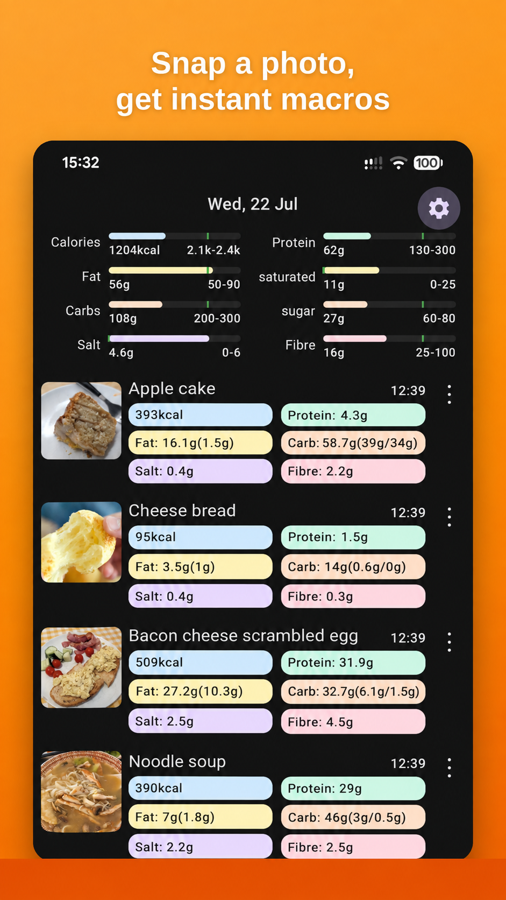
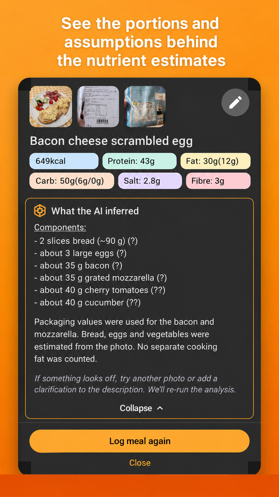
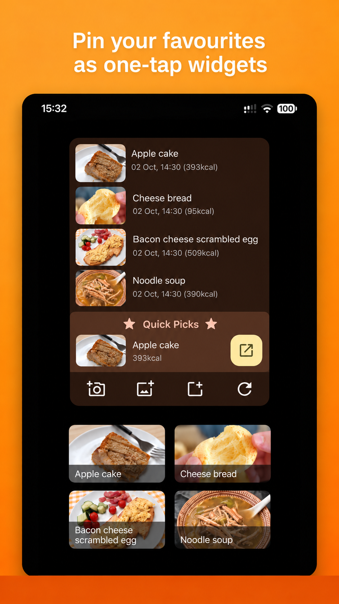

# Daily Macros

**A native Android food diary that turns meal photos into nutrition estimates.**

Snap a photo or describe a meal, review what the AI inferred, and keep track of calories and nutrients against your own targets. Home-screen widgets make logging regular meals a one-tap action.

[Website and testing information](https://gaborbiro.dev) · [Development builds](https://github.com/gaborbiro/DailyMacros/releases) · [Privacy policy](PRIVACY.md)

[](https://github.com/gaborbiro/DailyMacros/actions/workflows/android.yml)

## See it in action

<p>
  
  
  
</p>

[More screenshots](docs/screenshots/), including nutrient breakdowns and trends.

## What it does

- **Photo and text logging:** estimate calories, protein, fat, saturated fat, carbohydrates, sugar, salt and fibre.
- **Editable estimates:** review portions and assumptions, add information such as a nutrition-label photo, and correct the result.
- **Daily targets and trends:** see daily totals and compare days, weeks and months.
- **Quick repeat meals:** log favourites through Quick Picks and home-screen widgets.
- **Local diary storage:** keep records on the device, with optional backup to the user's own Google Drive.

Meal photos and descriptions are sent for AI analysis. See the [privacy policy](PRIVACY.md) for the data flow and available controls.

## Project status

Actively developed. The [website](https://gaborbiro.dev) has launch and testing information. [GitHub Releases](https://github.com/gaborbiro/DailyMacros/releases) contains automated development builds and pull-request previews; check each release's label before choosing a build.

Designed and developed by [Gabor Biro](https://github.com/gaborbiro).

## Engineering highlights

- **Modular Android architecture:** separate feature, repository/domain, data and core modules keep UI, persistence and external integrations organised.
- **Kotlin and Jetpack Compose:** ViewModels, Coroutines/Flow and Hilt support state, asynchronous work and dependency injection.
- **Persistence and backup:** Room stores diary data locally; the Google Drive backup implementation includes tests for app-variant isolation and compatibility with older backups.
- **AI integration:** a small Firebase Cloud Functions backend proxies OpenAI requests, keeping the service key out of the APK and applying request limits. See the [backend guide](functions/README.md).
- **Automated delivery:** GitHub Actions runs Android unit tests and builds debug APKs. A separate release workflow builds signed bundles and publishes to the Google Play internal track.

## Explore the code

| Area | Where to start |
|---|---|
| App setup and integration | [app/](app/) |
| Diary, meal editing, settings, trends and widgets | [features/](features/) |
| Domain contracts and repository implementations | [repositories/](repositories/) |
| Database, files and image handling | [data/](data/) |
| Shared design, analytics and feature flags | [core/](core/) |
| AI proxy and subscription verification | [functions/](functions/) |
| Build and release automation | [.github/workflows/](.github/workflows/) |

For examples of behaviour-focused tests, see [backup compatibility](repositories/backup/src/test/kotlin/dev/gaborbiro/dailymacros/repositories/backup/CloudSyncRepositoryImplTest.kt) and [diary-day handling](features/shared/src/test/java/dev/gaborbiro/dailymacros/features/shared/DiaryDayUtilsTest.kt).

## Build and test

Use **JDK 17**, Android Studio and the Android SDK required by the [version catalog](gradle/libs.versions.toml). Android SDK paths can be configured through Android Studio or `local.properties`.

Run unit tests:

```sh
./gradlew testDebugUnitTest
```

Build a debug APK:

```sh
./gradlew assembleDebug
```

On Windows, use `gradlew.bat` in place of `./gradlew`.

APK packaging requires a `SHAKE_API_KEY` in `local.properties` or the environment for tester feedback. Unit tests and lint do not require it. Running AI features also depends on the configured Firebase backend; deploying your own instance is covered in [functions/README.md](functions/README.md).

## Maintenance

[Release instructions and pending documentation updates](docs/maintenance.md) cover signing, version bumps and the privacy-text changes required before enabling currently hidden features.

